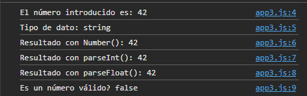
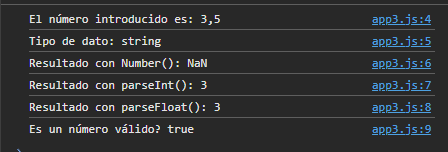
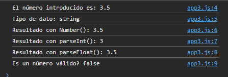
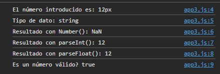
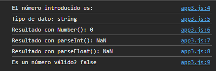

## 1.

| Expresión | Predicción | Resultado | Clasificación | Explicación |
| :--- | :--- | :--- | :--- | :--- |
| `'5' + 3` | `'53'` | `'53'` | Sorprendente | El operador + con una cadena realiza concatenación de texto en vez de suma matemática. |
| `'5' - 3` | `53` | `2` | Sorprendente | El operador `-` fuerza la conversión implícita de la cadena a número. |
| `'5' - '2'` | `3` | `3` | Esperable | Ambos operandos se convierten implícitamente a números para la resta. |
| `1 + 2 + '3'` | `'33'` | `'33'` | Esperable | Primero suma 1 + 2 = 3 y luego concatena con el '3' dando 33. |
| `'1' + 2 + 3` | `'15'` | `'123'` | Sorprendente | El operador + opera de izquierda a derecha: 1 + 2 concatena ('12'), y luego '12' + 3 vuelve a concatenar. |
| `true + true` | `2` | `2` | Esperable | true se convierte implícitamente a número (1), por lo que 1 + 1 = 2. |
| `'hola' - 2` | `NaN` | `NaN` | Esperable | No se puede convertir hola a un número válido, por lo que el resultado es NaN (Not a Number). |
| `null + 1` | `1` | `1` | Sorprendente | null se convierte en 0 en operaciones aritméticas. |
| `undefined + 1` | `NaN` | `NaN` | Esperable | undefined se convierte a NaN al intentar operar numéricamente con él. |
| `0.1 + 0.2 === 0.3` | `true` | `false` | Sorprendente | Problema de precisión con números de coma, da 0.30000000000000004, y === es que es estrictamente ese número y no es así, realmente es una aproximación. |
| `10 / 0` | `10` | `Infinity` | Sorprendente | En JavaScript dividir por cero positivo no da error, devuelve el valor especial Infinity. |
| `'10' < '9'` | `false` | `true` | Sorprendente | Comparación alfabética entre cadenas: el carácter '1' va antes que el '9'. |
| `10 < '9'` | `true` | `false` | Sorprendente | Convierte implícitamente la cadena '9' a número 9, evaluando 10 < 9. |
| `5 == '5'` | `true` | `true` | Esperable | La igualdad débil == adapta los datos antes de comparar. |
| `5 === '5'` | `false` | `false` | Esperable | La igualdad estricta === compara tanto el valor como el tipo de dato. |
| `0 == ''` | `true` | `true` | Sorprendente | Cadena vacía '' se convierte a número 0 mediante coerción débil. |
| `'' == '0'` | `true` | `false` | Esperable | Compara dos cadenas con distinto contenido ('' no es igual a '0'). |
| `null == undefined` | `true` | `true` | Esperable | Regla especial de JavaScript: null y undefined son equivalentes con ==. |
| `null === undefined` | `false` | `false` | Esperable | Son de tipos diferentes (object y undefined). |
| `NaN === NaN` | `true` | `false` | Sorprendente | Por definición de IEEE 754, NaN nunca es igual a sí mismo (se usa Number.isNaN() para comprobarlo). |
| `Boolean('false')` | `false` | `true` | Sorprendente | Cualquier cadena con contenido (incluso la palabra 'false') es un valor truthy. |
| `Boolean(0)` | `false` | `false` | Esperable | El número 0 es un valor falsy en JavaScript. |
| `Boolean('0')` | `false` | `true` | Sorprendente | Es una cadena con un carácter, por lo que es truthy (solo la cadena vacía es falsy). |
| `Boolean([])` | `false` | `true` | Sorprendente | Los arrays y objetos vacíos son siempre truthy en JavaScript. |
| `Number('')` | `0` | `0` | Esperable | Una cadena vacía se convierte al número 0. |
| `Number(' 12 ')` | `12` | `12` | Esperable | Los espacios en blanco alrededor se ignoran al convertir a número. |
| `Number('12px')` | `12` | `NaN` | Sorprendente | Contiene letras, por lo que Number() no puede convertirlo entero y falla devolviendo NaN. |
| `parseInt('12px')` | `12` | `12` | Esperable | Lee caracteres numéricos de izquierda a derecha hasta encontrar uno no válido p. |
| `parseInt('3.9')` | `3.9` | `3` | Sorprendente | parseInt trunca los decimales, devolviendo solo la parte entera 3. |
| `parseFloat('3.9')` | `3.9` | `3.9` | Esperable | Lee y respeta los decimales de la cadena numérica. |

## 2.

| Valor | Boolean(...) | Number(...) | String(...) |
| :--- | :--- | :--- | :--- |
| `' '` (un espacio) | `true` | `0` | `' '` |
| `'12.5'` | `true` | `12.5` | `'12.5'` |
| `-0` | `false` | `-0` | `'0'` |
| `Infinity` | `true` | `Infinity` | `'Infinity'` |
| `[]` | `true` | `0` | `''` |
| `[7]` | `true` | `7` | `'7'` |

## 3. Pruébalo con 42, 3,5 (con coma), 3.5, 12px, una cadena vacía, hola y Cancelar. Anota los resultados.

## 4.

El prompt siempre te devuelve un texto (string), aunque tú metas un número. Si intentas sumarle un 1 directamente con el operador +, JavaScript se lía y se piensa que quieres juntar los textos en vez de hacer una suma matemática. Para arreglarlo y que funcione bien, hay que convertir la entrada a número usando Number() antes de hacer la operación.