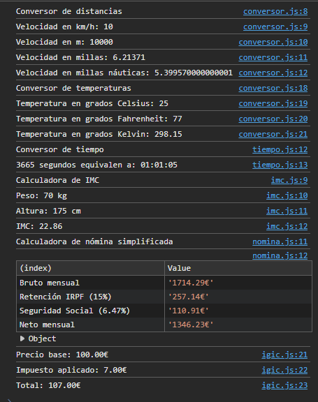
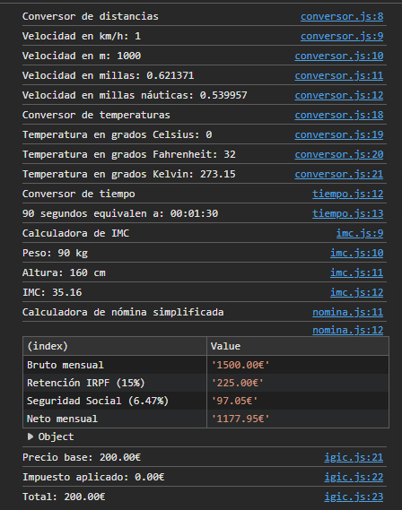
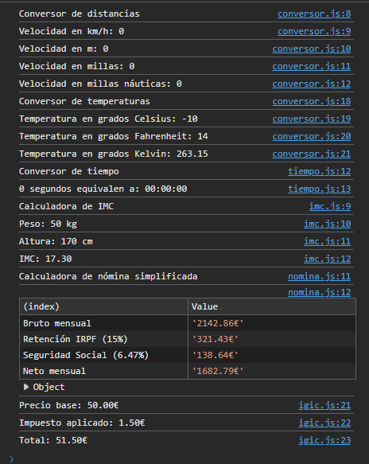

## 1. Conversor de Unidades
| Entrada (km / °C) | Esperado | Obtenido |
| :--- | :--- | :--- |
| `10 km`, `25 °C` | 10000 m, 6.21 mi, 5.40 NM / 77.00 °F, 298.15 K | (Comprobado en consola) |
| `1 km`, `0 °C` | 1000 m, 0.62 mi, 0.54 NM / 32.00 °F, 273.15 K | (Comprobado en consola) |
| `0 km`, `-10 °C` | 0 m, 0 mi, 0 NM / 14.00 °F, 263.15 K | (Comprobado en consola) |

## 2. Conversor de Tiempo
| Entrada (Segundos) | Esperado | Obtenido |
| :--- | :--- | :--- |
| `3665` | `01:01:05` | (Comprobado en consola) |
| `90` | `00:01:30` | (Comprobado en consola) |
| `0` | `00:00:00` | (Comprobado en consola) |

## 3. IMC (Índice de Masa Corporal)
| Entrada (Peso kg, Altura cm) | Esperado | Obtenido |
| :--- | :--- | :--- |
| `70 kg`, `175 cm` | `22.9` | (Comprobado en consola) |
| `90 kg`, `160 cm` | `35.2` | (Comprobado en consola) |
| `50 kg`, `170 cm` | `17.3` | (Comprobado en consola) |

## 4. Nómina Simplificada
| Entrada (Bruto Anual, Pagas) | Esperado | Obtenido |
| :--- | :--- | :--- |
| `24000`, `14` | Bruto: 1714.29 €, IRPF: 257.14 €, SS: 110.91 €, Neto: 1346.24 € | (Comprobado en consola) |
| `18000`, `12` | Bruto: 1500.00 €, IRPF: 225.00 €, SS: 97.05 €, Neto: 1177.95 € | (Comprobado en consola) |
| `30000`, `14` | Bruto: 2142.86 €, IRPF: 321.43 €, SS: 138.64 €, Neto: 1682.79 € | (Comprobado en consola) |

## 5. Precio con IGIC
| Entrada (Base, Tipo IGIC) | Esperado | Obtenido |
| :--- | :--- | :--- |
| `100`, `7` | Impuesto: 7.00 €, Total: 107.00 € | (Comprobado en consola) |
| `200`, (Cancelar / por defecto) | Impuesto: 14.00 €, Total: 214.00 € | (Comprobado en consola) |
| `50`, `3` | Impuesto: 1.50 €, Total: 51.50 € | (Comprobado en consola) |

