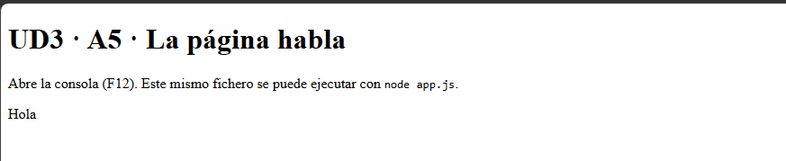
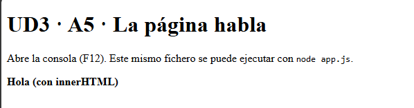
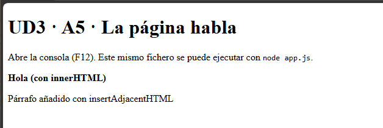

## 1. Diferencias

* **`textContent`**: Mete solo texto plano. Si le metes una etiqueta HTML (como un `<strong>`), te la escribe literal en la pantalla y se carga todo lo que había antes en el contenedor.

* **`innerHTML`**: Te interpreta el HTML (te pone las negritas, etc.), pero al igual que el anterior, borra todo lo que había antes para poner lo nuevo.

* **`insertAdjacentHTML`**: Te deja meter HTML nuevo (por ejemplo, al final con `'beforeend'`) sin borrar lo que ya estaba en pantalla. Es el que usas cuando quieres ir acumulando cosas.
